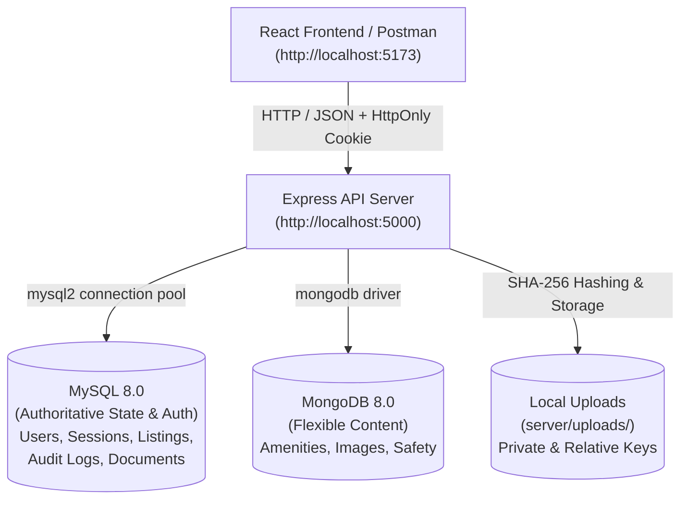
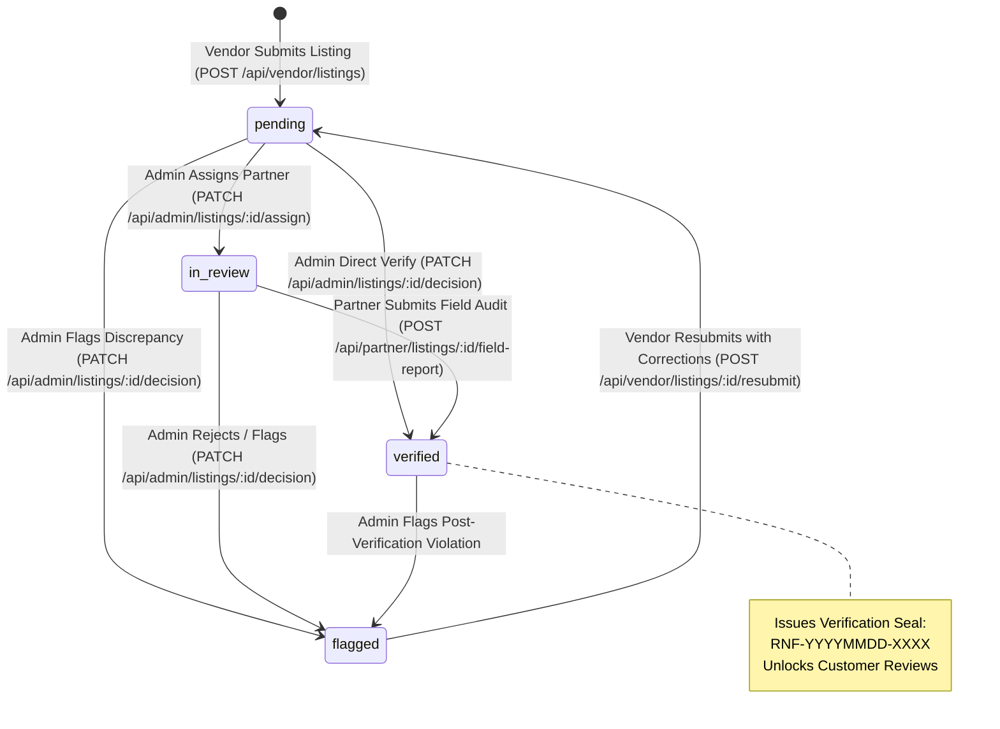

# Rentify Backend Server

Production-grade, zero-trust backend REST API service for the Rentify platform. Built with Node.js (ES modules), Express, MySQL 8, and MongoDB 8.

The architecture uses **MySQL 8 as the authoritative source of truth** for identity, transactions, verification states, audit logs, and business rules, paired with **MongoDB 8 for flexible, document-based property details** (amenities, high-resolution media galleries, and physical safety tags).

---

## Architecture Overview



- **Shared Primary Key**: `listings.id` (UUIDv4 in MySQL) matches `_id` (string in MongoDB `property_details`).
- **Zero-Trust File Storage**: Documents and photos are checked for MIME types, hashed with SHA-256, given random unguessable storage keys, and stored privately under `server/uploads/<listingId>/`. They are never served statically.
- **Tamper-Evident Audit Trail**: All status transitions, assignments, audits, and customer feedback are recorded in an append-only `audit_logs` table protected by MySQL triggers.

---

## Quick Start (Zero to Running)

### Prerequisites
- **Node.js** >= `20.6.0` (supports native `--env-file`)
- **Docker & Docker Compose** (for running MySQL 8 and MongoDB 8)
- **npm** >= `10.0.0`

### 1. Database Provisioning & Seeding
From the project root:
```bash
# 1. Move to database directory
cd database

# 2. Setup database environment variables
cp .env.example .env
# Edit .env if desired (default passwords work out-of-the-box for local testing)

# 3. Install database script dependencies
npm install

# 4. Spin up Docker containers (MySQL on :3306, Mongo on :27017)
npm run db:up

# 5. Run migrations, MongoDB validator initialization, seeding, and verification
npm run db:setup
```
Confirm the terminal ends with: `VERIFY PASSED`.

### 2. Server Installation & Configuration
From the project root:
```bash
# 1. Move to server directory
cd ../server

# 2. Setup server environment variables
cp .env.example .env
# Ensure MYSQL_PASSWORD and MONGO_APP_PASSWORD match your database/.env

# 3. Install server dependencies
npm install

# 4. Start the server in development mode
npm run dev
```
The server will start listening at `http://localhost:5000` with hot-reloading.

### 3. Running the Test Suite
All tests execute against the running Docker databases, asserting on real transactions, trigger guards, and session states:
```bash
cd server
npm test
```

---

## Environment Variables Reference

Validated on startup using **Zod** (`src/config/env.js`). Missing or invalid configuration causes a fast fail with descriptive error messages.

| Variable | Type | Default | Description |
|---|---|---|---|
| `PORT` | Number | `5000` | Port on which Express listens. |
| `NODE_ENV` | Enum | `development` | Environment mode (`development`, `production`, `test`). |
| `CORS_ORIGIN` | String / URL | `http://localhost:5173` | Allowed origin for Cross-Origin Resource Sharing. |
| `SESSION_TTL_HOURS` | Number | `72` | Session lifetime in hours before token expiry. |
| `DEV_OTP` | String | `123456` | Static OTP bypass for local testing. Must be changed in production. |
| `UPLOAD_DIR` | String | `uploads` | Local directory path for storing uploaded files. |
| `MYSQL_HOST` | String | `127.0.0.1` | MySQL server host. |
| `MYSQL_PORT` | Number | `3306` | MySQL server port (mapped from Docker). |
| `MYSQL_DATABASE` | String | `rentify` | Name of MySQL database schema. |
| `MYSQL_USER` | String | `rentify` | Non-root application user for MySQL. |
| `MYSQL_PASSWORD` | String | `change_me_mysql` | Password for MySQL application user. |
| `MYSQL_SSL` | Boolean | `false` | Enable TLS/SSL connection to MySQL. |
| `MYSQL_SSL_CA` | String | _none_ | Path to CA cert file or pasted PEM string. |
| `MONGO_URI` | String | _none_ | Full MongoDB connection string (e.g. `mongodb+srv://...`). |
| `MONGO_HOST` | String | `127.0.0.1` | MongoDB server host (used when `MONGO_URI` is omitted). |
| `MONGO_PORT` | Number | `27017` | MongoDB server port (mapped from Docker). |
| `MONGO_DB` | String | `rentify` | Name of MongoDB database. |
| `MONGO_APP_USER` | String | `rentify_app` | MongoDB user scoped to `rentify` database (used when `MONGO_URI` omitted). |
| `MONGO_APP_PASSWORD` | String | `change_me_mongo_app` | Password for MongoDB application user (used when `MONGO_URI` omitted). |

---

## Verification Lifecycle & State Machine

Status transitions are strictly guarded by MySQL triggers (`trg_listings_guard_update`), preventing invalid out-of-order changes:



---

## API Endpoint Catalog

All authenticated routes use **HTTP-Only, SameSite=Lax** session cookies (`rentify_session`), validated against the MySQL `sessions` table.

### 1. Authentication (`/api/auth`)
| Method | Path | Auth Required | Description |
|---|---|---|---|
| `POST` | `/api/auth/send-otp` | Public | Generates dev OTP for phone; uniform timing-safe response. |
| `POST` | `/api/auth/verify-otp` | Public | Validates OTP, creates MySQL session, issues `rentify_session` cookie. |
| `GET` | `/api/auth/me` | Authenticated | Returns current active user profile, permissions, and session info. |
| `POST` | `/api/auth/logout` | Authenticated | Revokes session hash in MySQL and clears client cookie. |

### 2. Public Listings (`/api/listings`)
| Method | Path | Auth Required | Description |
|---|---|---|---|
| `GET` | `/api/listings` | Public | Multi-attribute search (city, rent range, type, sorting, pagination). |
| `GET` | `/api/listings/:id` | Public | Full listing view (masked documents, audits, amenities, images). |

### 3. Customer Workspace (`/api`)
| Method | Path | Role | Description |
|---|---|---|---|
| `GET` | `/api/listings/recommended` | `customer` | Top 10 verified recommendations scored across budget, locality, safety, credibility, and tenant ratings with plain-English reasons. |
| `GET` | `/api/me/saved` | `customer` | Lists all bookmarked properties for customer. |
| `POST` | `/api/me/saved/:listingId` | `customer` | Saves a listing (idempotent, pinned by foreign keys). |
| `DELETE` | `/api/me/saved/:listingId` | `customer` | Removes a listing from saved list. |
| `POST` | `/api/listings/:id/feedback` | `customer` | Submits 1-5 star review and comment on verified listing. |

### 4. Vendor Workspace (`/api/vendor`)
| Method | Path | Role | Description |
|---|---|---|---|
| `POST` | `/api/vendor/listings` | `vendor` | Submits property with multipart documents & photos (status: `pending`). |
| `GET` | `/api/vendor/listings` | `vendor` | Returns all listings owned exclusively by the authenticated vendor. |
| `POST` | `/api/vendor/listings/:id/resubmit` | `vendor` | Clears flags and returns listing to `pending` queue. |

### 5. Admin Registrar (`/api/admin`)
| Method | Path | Role | Description |
|---|---|---|---|
| `GET` | `/api/admin/queue` | `admin` | Triage queue of pending and in-review listings (oldest first). |
| `GET` | `/api/admin/listings/:id` | `admin` | Full listing details + real-time computed rule-based fraud detection signals. |
| `GET` | `/api/admin/listings/:id/documents` | `admin` | Inspects verification documents and cryptographic hashes. |
| `PATCH` | `/api/admin/listings/:id/assign` | `admin` | Assigns verified partner from matching city (`pending` -> `in-review`). |
| `PATCH` | `/api/admin/listings/:id/decision` | `admin` | Approves (`verified`) or flags with reason (`flagged`). |

### 6. Field Partner (`/api/partner`)
| Method | Path | Role | Description |
|---|---|---|---|
| `GET` | `/api/partner/assignments` | `partner` | Lists pending physical audits assigned to the partner. |
| `POST` | `/api/partner/listings/:id/field-report` | `partner` | Records checklist, creates seal `RNF-YYYYMMDD-XXXX`, transitions to `verified`. |

### 7. Rental Assistance & Metadata (`/api`)
| Method | Path | Auth Required | Description |
|---|---|---|---|
| `GET` | `/api/assistance/calculator-params` | Public | Returns rent-to-income limits and deposit loan tiers. |
| `POST` | `/api/assistance/calculate` | Public | Evaluates financial readiness, EMI schedules, and credit scores. |
| `GET` | `/api/cities` | Public | Returns supported cities (Nagpur, Pune). |
| `GET` | `/health` | Public | Healthcheck for Node.js, MySQL pool, and MongoDB connection. |

---

## Seeded Demo Accounts & Development OTP

Development OTP for all seeded accounts is: **`123456`**

| Role | Name | Phone Number | Location / Badge |
|---|---|---|---|
| **Customer** | Aarav Sharma | `+91 00000 00001` | Pune |
| **Vendor** | Rajesh M. Sharma | `+91 00000 00002` | Pune |
| **Admin** | Arvind Mehta | `+91 00000 00003` | Registrar Lead |
| **Partner** | Amit Patil | `+91 00000 00004` | Nagpur (Badge #NGP-7721) |
| **Partner** | Pooja Kulkarni | `+91 00000 00005` | Pune (Badge #PUN-4091) |

---

## Testing & Quality Assurance

The test suite runs against the real running databases, verifying:
- **Authentication**: Session creation, SHA-256 token hashing, expiry enforcement, logout revocation, and rate limiting.
- **RBAC**: Strict HTTP 401/403 verification matrix across every protected role.
- **Search & Filters**: Multi-attribute parametric queries, pagination, and sorting.
- **Verification Workflow**: Complete lifecycle transitions, verification seal generation, and trigger guard violation handling (HTTP 409).
- **Vendor Isolation**: Proof that vendors cannot see or modify other vendors' listings.
- **Data Integrity**: Append-only audit logs, rating recalculations, and saved listing idempotency.

Run the test suite anytime with:
```bash
npm test
```

A Postman collection is available at `server/postman/Rentify.postman_collection.json`.
